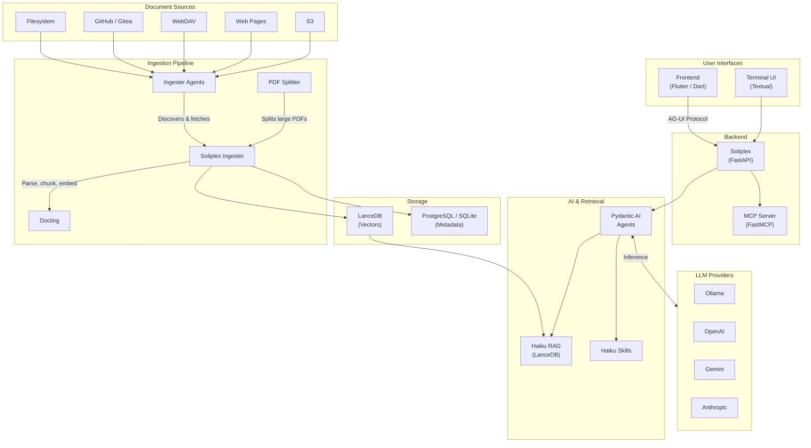

# Soliplex Documentation

Welcome to the Soliplex ecosystem documentation. Soliplex provides AI-powered retrieval-augmented generation capabilities for intelligent document search and question answering.

## Soliplex Architecture

## Core Components

### [Soliplex Platform](soliplex/overview.md)

The main Soliplex RAG system with FastAPI backend and Flutter frontend.

**Quick Links:**
- [Overview](soliplex/overview.md)
- [Server Setup](soliplex/server.md)
- [Client Setup](soliplex/client.md)
- [RAG Database](soliplex/rag.md)
- [Configuration Guide](soliplex/config/installation.md)
- [Usage](soliplex/usage.md)

## Deployment

### [Docker Compose Template](template/index.md)

A Docker Compose template that assembles a full Soliplex stack (nginx-served Flutter frontend, backend, haiku.rag document pipeline, docling-serve, Postgres) and a generator for producing your own tailored stack from it.

**Quick Links:**
- [Overview](template/index.md)
- [Generate a Project](template/getting-started/generator.md)
- [Tutorial: First Steps](template/getting-started/tutorials/01-first-steps.md)
- [Installation](template/users/installation.md)
- [Upgrading a Generated Stack](template/upgrades/index.md)

### [Concierge](concierge/index.md)

Soliplex extension for LLM-driven, on-demand room requests: users ask a self-serve "about" room for access to a non-public room or for a new room, and the concierge provisions it or files a tracking issue for an administrator.

**Quick Links:**
- [Overview](concierge/index.md)
- [Room Setup](concierge/tasks/rooms/setup.md)
- [Administering Requests](concierge/tasks/admin/index.md)
- [Skills](concierge/skills/index.md)
- [CLI Scripts](concierge/reference/cli.md)

## User Interfaces

### Flutter Client

Cross-platform mobile and desktop client application for Soliplex.

**Quick Links:**
- [Developer Setup Guide](frontend/developer-setup.md)
- [Send / Cancel Lifecycle](frontend/send-cancel-lifecycle.md)

### [Chatbot Widget](chatbot-widget/readme.md)

Embeddable Next.js chat widget for integrating Soliplex into web applications.

**Quick Links:**
- [Documentation](chatbot-widget/readme.md)
- [Usage Guide](chatbot-widget/usage.md)

## Supporting Tools

### [Ingester Agents](ingester-agents/index.md)

Agents for ingesting documents from various sources (filesystem, GitHub, Gitea, WebDAV, web pages) into a Soliplex RAG pipeline.

**Quick Links:**
- [Documentation](ingester-agents/index.md)

### [Exquisite](exquisite/index.md)

Corpus management for evaluations: labels question sets with the documents in a RAG database that answer them, so retrieval can be scored.

**Quick Links:**
- [Documentation](exquisite/index.md)
- [Worksheets](exquisite/worksheets.md)
- [Binding](exquisite/binding.md)

## Getting Started

### For New Users

1. [Core Platform Overview](soliplex/overview.md) - Understanding the Soliplex system
2. [Server Setup](soliplex/server.md) - Set up the backend server
3. [Client Setup](soliplex/client.md) - Configure the client application
4. [Docker Compose Template](template/getting-started/tutorials/01-first-steps.md) - Run a full stack with Docker Compose

### For Developers

1. [Core Platform Architecture](soliplex/overview.md) - System design and components
2. [Stack Services](template/users/architecture/services.md) - How a deployed stack fits together
3. [Concierge Python API](concierge/reference/api.md) - Concierge library reference

### For Operations

1. [Configuration Guide](soliplex/config/installation.md) - Installation configuration
2. [Environment Setup](soliplex/config/environment.md) - Environment variables
3. [Secrets Management](soliplex/config/secrets.md) - Handling sensitive configuration
4. [Generate a Project](template/getting-started/generator.md) - Create your own stack from the template
5. [Database Migrations](template/users/operations/migrations.md) - Migrating a generated stack's databases

## What is Soliplex?

Soliplex combines the power of retrieval systems with generative AI to provide accurate, contextual responses based on your document collections. The system indexes your documents and uses them to enhance AI responses with relevant, up-to-date information.

### Key Features

- **RAG-Powered Search**: Semantic document retrieval using LanceDB vector database
- **Multi-Room Architecture**: Independent chat environments with separate configurations
- **Multiple LLM Providers**: OpenAI, Ollama, and compatible APIs
- **Document Ingestion**: Robust pipeline for loading and processing documents
- **Real-time Communication**: WebSocket-based conversation streams
- **OIDC Authentication**: Enterprise SSO with Keycloak integration

## Documentation Updates

This documentation is automatically synchronized from multiple repositories:

- **Core Platform**: [soliplex/soliplex](https://github.com/soliplex/soliplex)
- **Docker Compose Template**: [soliplex/soliplex-template](https://github.com/soliplex/soliplex-template)
- **Concierge**: [soliplex/soliplex-concierge](https://github.com/soliplex/soliplex-concierge)
- **Flutter Client**: [soliplex/frontend](https://github.com/soliplex/frontend)
- **Chatbot Widget**: [soliplex/chatbot](https://github.com/soliplex/chatbot)
- **Ingester Agents**: [soliplex/ingester-agents](https://github.com/soliplex/ingester-agents)
- **Bubble Sandbox**: [soliplex/bubble-sandbox](https://github.com/soliplex/bubble-sandbox)
- **Exquisite**: [soliplex/exquisite](https://github.com/soliplex/exquisite)

Documentation is updated automatically when changes are made to the source repositories via git submodules.
